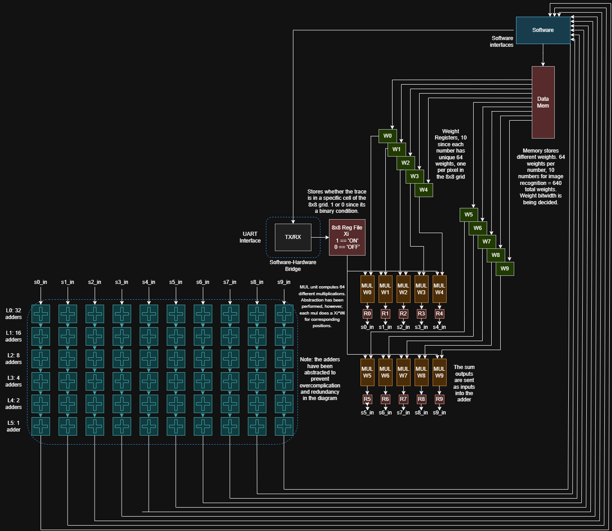
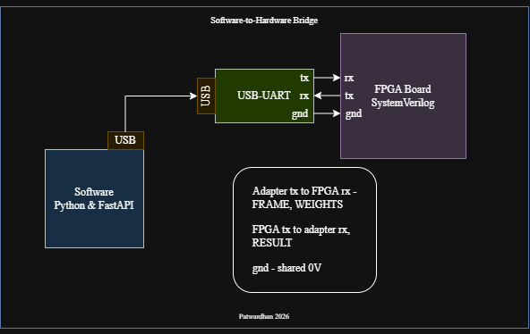

# Synapse

Identify a digit, 0 through 9, from an 8×8 grid of light cells. Each cell is an unsigned brightness, 0 through 255. Each digit owns a signed weight for every cell. The digit with the largest sum of brightness times weight is the prediction.

```text
light on a cell  →  one brightness byte  →  ten weighted sums  →  the winning digit
```

The sensing happens in a small analog circuit on each cell. The multiply and the sum happen after those bytes exist. On the Von Neumann path the weights live in memory, and the same stored weights are reused for the next frame.

## 8×8 datapath



Software owns the frame and the weights. The frame is 64 unsigned bytes, one brightness per cell. Each digit has its own 64 weights, so memory holds 10 × 64 = 640 weights. A UART link is the bridge. The host writes the brightnesses into an 8×8 register file and writes each digit's weights into `W0` through `W9`.

`score.sv` computes `x[i] * w[i]` for one digit. The 64 products then fold down an adder tree:

| Stage | Adders | What they combine |
|---|---|---|
| L0 | 32 | 64 products, taken in pairs |
| L1 | 16 | the 32 pair-sums |
| L2 | 8 | |
| L3 | 4 | |
| L4 | 2 | |
| L5 | 1 | the score for that digit |

Ten passes through that sum produce `s0` through `s9`. The largest score is the prediction. A tie stays a tie. Each 22-bit sum is sign-extended into a 32-bit integer and sent as four UART bytes. A UART frame holds eight data bits, so the 22-bit sum is not one word between a single start bit and stop bit.

Each weight is a signed 8-bit number, from −128 to 127. One product fits in signed 16 bits: 255 × −128 = −32,640. Sixty-four of those products reach −2,088,960, so the accumulator is signed 22-bit.

## Software to hardware



The browser is TypeScript. It posts the picture to a Python FastAPI server. That server is the side that opens the serial port. One USB cable runs from the laptop to a USB-UART adapter. The adapter is the only translator. Python speaks bytes. The FPGA speaks a pin that sits high or low. The chip on the adapter, commonly an FT232, CP2102, or CH340, turns one into the other.

Three jumpers leave the adapter. Each `tx` pin faces the other machine.

| Adapter | FPGA, DE1-SoC GPIO_0 | Quartus pin | What moves |
|---|---|---|---|
| TX | `rx` | `PIN_AC18` | `FRAME` and `WEIGHTS`, into the board |
| RX | `tx` | `PIN_Y17` | `RESULT`, back to Python |
| GND | GND | | shared 0 V, no bits |

The adapter is 3.3 V. Its 5 V pin stays unconnected. The 50 MHz clock is already on the board at `PIN_AF14`. The USB-Blaster is a second cable and only loads the bitstream.

The line is 115200 baud, 8 data bits, no parity, 1 stop bit, least-significant bit first. One bit is 434 clocks of the 50 MHz clock, 8.68 µs. A byte on the wire is a low start bit, eight data bits, and a high stop bit, 86.8 µs.

`FRAME` is 64 bytes. Cell 0 is byte 0, and each byte is that cell's brightness, 0 through 255. `WEIGHTS` is one digit byte plus 64 signed weight bytes. The weights are loaded once and then kept. Each later picture is the 64-byte frame.

A byte on the wire is 10 bit-times, 86.8 µs. The 64 brightness bytes take 5.56 ms. With the sync, opcode, length, and checksum, a `FRAME` packet is 68 bytes, 5.9 ms. Ten `WEIGHTS` packets are 690 bytes, 59.9 ms. The `RESULT` packet is 46 bytes, 4.0 ms.

`rtl/uart_rx.sv` samples `rx` into bytes. `rtl/score.sv` multiplies one digit. `rtl/uart_tx.sv` drives `tx` one byte at a time. `rtl/synapse_top.sv` is where those three meet the pins.

## Cell

The brightness comes from one analog circuit per cell. The weight is not in this circuit. The LDR sets the level. The byte that enters `score.sv` keeps that level, from 0 through 255.

```text
Vdd
 │
LDR                        resistance falls when the cell is lit
 │
 ├─ VL ── C ────── GND     holds the voltage
 │        Rb ───── GND     sets the dark level
 │        Reset ── GND     clears the cell before the next frame
 │
Rser
 │
 ├──────── (+) comparator
 │           (−) comparator  = VTH
Rh
 │
x                          unsigned byte, 0 through 255, from VL
```

| Part | What it does |
|---|---|
| `LDR`, `Rb` | A divider. Light lowers the LDR resistance, so `VL` rises. Darkness makes `VL` fall toward 0. |
| `C` | Holds `VL` and slows the edges. A brief shadow does not change the byte by itself. |
| `Reset` | Shorts `C` to ground before the next frame, so a cell that was bright can return to 0. |
| Comparator | `Vo` is 1 when `VL` is above `VTH`, and 0 otherwise. The score uses the brightness byte rather than this one-bit `Vo`. |
| `Rh`, `Rser` | A little of `Vo` shifts the threshold. Once the bit is 1, it takes a slightly lower voltage to fall back to 0, so the bit does not chatter on the threshold. |

```text
VL  →  Vdd · Rb / (Rb + LDR)
```

A frame is one pass over the grid:

1. Close `Reset`. Every capacitor is forced to ground.
2. Open `Reset`. Light on each LDR starts charging that cell's `C`.
3. Wait the same settle time on every frame. It has to be long enough for the dimmest stroke that should still count.
4. Sample all 64 cells into unsigned bytes `x[0]` through `x[63]`.
5. Compute the ten scores and send them back with the winning digit.

## Score

Number the cells in row-major order. Cell 0 is the first byte. Digit `d` scores

```text
score(d)  =  Σ  w(d, i) · x(i)     i = 0 … 63
```

`x(i)` is an unsigned byte, 0 through 255. `w(d, i)` is a signed byte, −128 through 127. A dark cell adds nothing, because its brightness is 0. A brighter cell adds a larger share of the weight. Negative weights are allowed: a bright cell can vote against a digit. A cell that is bright only for an 8 should carry a large positive weight on 8 and a small or negative weight on the digits that are dark there.

```text
x        =  [ 200,  0,  50 ]
w(0)     =  [   1,  1,  −1 ]     score(0) = 200·1 + 0·1 + 50·(−1) = 150
w(1)     =  [   1, −1,   1 ]     score(1) = 200·1 + 0·(−1) + 50·1 = 250
```

The middle cell is dark, so its weights add nothing. The third cell is partly bright, which counts for digit 1 and against digit 0. The prediction is 1.

The weights come from example digits and are then held fixed. The grid is reliable when one digit fills it, stays centered, and is much brighter than an empty cell. It classifies the pattern already sitting on the cells. It does not search a page for a digit.

The same cells stop lining up with the weights when the digit is shifted by a cell, drawn larger or smaller than the examples, drawn with a much thicker or thinner stroke, or written in a hand the weights never saw. Ambient light raises empty cells above 0. An 8 and a 0 differ by only a few middle cells, so one cell whose brightness is far from the examples can swap the winner. The weights have to be trained on brightnesses from 0 through 255. A weight chosen for a lit-or-dark cell gets multiplied by as much as 255.

## Outputs

| Output | What it is |
|---|---|
| Brightness | The 8×8 image, one unsigned byte per cell |
| Scores | Ten 22-bit sums, sent as ten little-endian 32-bit integers |
| Digit | The winner of those scores. A tie is reported as a tie. |
