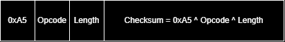

**Author:** Rohtak Patwardhan  
**Date:** 10/21/2026

> Note: the following file explains the data transmission and packet theory behind our frame, packet, and weights RTL files.

---

Data sent merely by UART has no true significance by itself. A weight and brightness may not have any significance without a packet and designated fields to help with associating necessary information of the data being transmitted.

That's why we separated the info into designated fields, with `0xA5` being the byte to detect to signify that a packet is starting.

"`uart_rx`" hands just a byte with no information about whether it's a weight or a brightness. That's why we can separate it using different opcodes.

---

We decided to use the following opcodes for Synapse:

|  |  |  |
| --- | --- | --- |
| `0x01` | PING | empty payload |
| `0x02` | FRAME | 64 brightness bytes, one per cell, representing the 8x8 grid |
| `0x03` | WEIGHTS | 1 byte for the digit (0-9), then 64 signed bytes for weights |
| `0x04` | RUN | empty payload |

---

The length byte represents a count, not a pile of bytes. After the parser sees `0xA5` and an opcode, it doesn't know how many bytes will actually come. The next byte says "you should read this many bytes, then the byte following is a checksum for validity."

Since a ping has a `0x00` length, it can be written as "`A5 01 00 A4`".

This is how it's derived ...



```text
A5 is the start sequence,
01 is the opcode
00 is the length

XOR computation (A5 ^ 01 ^ 00):
1010 0101
0000 0001
0000 0000
---------
1010 0100
```

---

Which is equivalent to `A4`. That's how the checksum equals `A4`. On a larger scale, for brightness and weights, the checksum consists of many, many bytes being XOR'd together, and the length byte is inside that XOR the same way `00` is inside the ping.

A picture is `A5 ^ 02 ^ 40 ^ cell0 ^ … ^ cell63`. 64 brightness bytes is the length value `0x40`.

One weight grid is `A5 ^ 03 ^ 41 ^ digit ^ w0 ^ … ^ w63`. The digit byte plus 64 weights is 65, and 65 is the length value `0x41`.

> When that result does not match the last byte, the picture or the weight grid is not stored. The reply is a NACK for a bad checksum.
